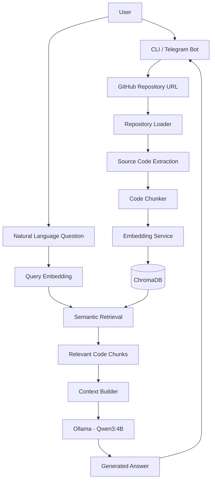

# Repozium — AI-Powered GitHub Repository Intelligence Assistant

<p align="center">
  <strong>Understand codebases. Explore repositories. Get intelligent answers.</strong>
</p>

<p align="center">
  
  
  
  
  
</p>

---

## 1. Overview

**Repozium** is an AI-powered GitHub Repository Intelligence Assistant designed to simplify the process of understanding and exploring software repositories.

Understanding an unfamiliar codebase can be challenging, especially when a repository contains multiple directories, hundreds of source files, interconnected classes, functions, and complex execution flows.

Repozium addresses this problem by combining **Retrieval-Augmented Generation (RAG), semantic code search, vector embeddings, and Large Language Models (LLMs)** to provide context-aware answers about GitHub repositories.

Users can provide a public GitHub repository URL and ask natural-language questions about its source code. Repozium retrieves relevant code sections from the indexed repository and uses an LLM to generate explanations based on the retrieved context.

It supports both a command-line interface and a Telegram chatbot interface.

## 2. Problem Statement

Developers frequently encounter difficulties when working with unfamiliar or large software repositories.

Some common challenges include:

- Understanding the overall architecture of an unfamiliar project.
- Identifying the purpose of individual classes, functions, and modules.
- Tracing how data flows between controllers, services, repositories, and databases.
- Finding relevant code across multiple files.
- Spending significant time manually navigating source code.
- Understanding dependencies and relationships between different components.

Traditional keyword-based code searching often fails to capture the semantic meaning of a developer's question.

Repozium aims to make repository exploration more intuitive by allowing developers to interact with codebases using natural language.

## 3. Key Features

### 3.1 GitHub Repository Ingestion

- Accepts public GitHub repository URLs.
- Clones repositories automatically.
- Extracts supported source files.
- Skips unnecessary directories and sensitive files.
- Avoids processing oversized files.
- Prepares repository content for indexing.

### 3.2 Intelligent Code Chunking

- Divides source code into smaller, manageable chunks.
- Uses Python AST parsing to extract classes, functions, and methods.
- Uses recursive text splitting for other supported file types.
- Preserves useful metadata such as file paths, language, class names, function names, and line ranges.

### 3.3 Semantic Code Search

- Converts code chunks into vector embeddings.
- Stores embeddings in ChromaDB.
- Converts user questions into query embeddings.
- Retrieves semantically relevant code sections.
- Removes duplicate content from retrieved results.

### 3.4 Retrieval-Augmented Generation (RAG)

- Combines retrieved source code with user questions.
- Supplies repository context to the language model.
- Generates explanations grounded in retrieved code.
- Supports questions about project structure, functionality, and execution flow.

### 3.5 Local LLM Integration

- Uses Ollama to run language models locally.
- Uses Qwen3:4B for answer generation by default.
- Avoids requiring a paid hosted LLM API for local inference.
- Provides control over generation parameters.

### 3.6 Telegram Chatbot Integration

- Provides a conversational interface through Telegram.
- Accepts GitHub repository URLs.
- Indexes repositories through the bot.
- Allows users to ask questions directly in Telegram.
- Supports commands such as `/start`, `/help`, `/repo`, `/status`, and `/clear`.

### 3.7 Persistent Vector Storage

- Uses ChromaDB for persistent vector storage.
- Maintains indexed repository chunks between application runs.
- Uses separate collection names for different Telegram user and repository combinations.

## 4. System Architecture

Repozium follows a Retrieval-Augmented Generation architecture.

### High-Level Architecture



### Main Components

| Component | Responsibility |
|---|---|
| Repository Loader | Clones repositories and extracts source files |
| Code Chunker | Splits source code into manageable chunks |
| Embedding Service | Generates vector representations of code and queries |
| Vector Store | Stores and searches embeddings using ChromaDB |
| Retriever | Retrieves relevant repository code |
| Context Builder | Organizes retrieved code for the language model |
| LLM Service | Generates natural-language answers |
| Chatbot | Handles Telegram interactions |
| Query Engine | Connects retrieval and answer generation |

## 5. Technology Stack

| Technology | Purpose |
|---|---|
| Python | Core application development |
| Ollama | Local LLM execution |
| Qwen3:4B | Natural-language answer generation |
| ChromaDB | Vector database |
| Sentence Transformers | Text and code embeddings |
| all-MiniLM-L6-v2 | Embedding model |
| LangChain Text Splitters | Recursive text chunking |
| Python AST | Python code structure extraction |
| Git | Repository cloning |
| GitHub | Source repository hosting |
| python-telegram-bot | Telegram chatbot integration |
| python-dotenv | Environment variable management |

### Embedding Model

Repozium uses:

`sentence-transformers/all-MiniLM-L6-v2`

This model converts code chunks and user questions into 384-dimensional vector embeddings.

These embeddings allow ChromaDB to retrieve semantically similar content rather than relying only on exact keyword matches.

### Language Model

Default model:

`qwen3:4b`

The model runs locally through Ollama and generates answers using the retrieved repository context.

## 6. How Repozium Works

The complete workflow consists of two major pipelines.

### A. Repository Indexing Pipeline

**Step 1 — Repository URL Input**

The user provides a public GitHub repository URL.

Example:

```text
https://github.com/username/repository-name
```

**Step 2 — Repository Cloning**

The Repository Loader clones the repository into a local workspace using Git.

It skips unnecessary directories such as:

- `.git`
- `node_modules`
- `venv`
- `__pycache__`
- `dist`
- `build`

It also excludes selected sensitive files and oversized files.

**Step 3 — Source Code Extraction**

The loader reads supported files and extracts their contents.

Currently supported extensions include:

`.py`, `.java`, `.js`, `.ts`, `.cpp`, `.c`, `.go`, `.rs`, `.md`, `.txt`

**Step 4 — Code Chunking**

The Code Chunker divides extracted source code into smaller sections.

For Python files, AST parsing is used to extract classes, functions, and methods.

For other supported languages, recursive character-based text splitting is used.

The configured chunking parameters are:

- Chunk size: 1200 characters
- Chunk overlap: 200 characters

Metadata is associated with each chunk wherever available.

**Step 5 — Embedding Generation**

Each chunk is converted into a numerical vector using Sentence Transformers.

This allows code to be searched based on semantic similarity.

**Step 6 — Vector Storage**

The generated embeddings, source code, and metadata are stored in ChromaDB.

The database uses persistent local storage, allowing indexed data to remain available across application restarts.

### B. Question Answering Pipeline

**Step 1 — User Question**

The user asks a question in natural language.

Example:

```text
Explain how candidate registration works
from controller to database.
```

**Step 2 — Query Embedding**

The user's question is converted into a vector embedding using the same embedding model.

**Step 3 — Semantic Retrieval**

The Retriever searches ChromaDB for code chunks that are semantically similar to the question.

The current implementation retrieves candidate chunks and selects relevant results while attempting to include different source files.

**Step 4 — Context Construction**

The retrieved chunks are organized into a structured context containing information such as:

- Source file path
- Programming language
- Chunk type
- Class name
- Function name
- Source line range
- Actual source code

**Step 5 — LLM Processing**

The context and user question are passed to Qwen3:4B through Ollama.

The model is instructed to answer based on the supplied repository context.

**Step 6 — Answer Generation**

Repozium generates a natural-language explanation and returns it through the CLI or Telegram chatbot.

## 7. Project Structure

```text
Repozium/
│
├── bot.py
├── ingest.py
├── query.py
├── requirements.txt
├── README.md
├── .gitignore
│
├── src/
│   ├── __init__.py
│   ├── chatbot.py
│   ├── chunker.py
│   ├── embeddings.py
│   ├── loader.py
│   ├── llm.py
│   ├── prompts.py
│   ├── retriever.py
│   └── vectorstore.py
│
├── tests/
│   ├── test_llm.py
│   ├── test_retriever.py
│   └── test_vectorstore.py
│
├── data/
│   └── chroma/
│
└── workspace/
```

### Important Files

| File | Description |
|---|---|
| `bot.py` | Entry point for the Telegram bot |
| `ingest.py` | Handles repository ingestion and indexing |
| `query.py` | Implements the RAG question-answering pipeline |
| `src/loader.py` | Clones repositories and extracts source files |
| `src/chunker.py` | Performs source code chunking |
| `src/embeddings.py` | Generates embeddings |
| `src/vectorstore.py` | Handles ChromaDB operations |
| `src/retriever.py` | Retrieves relevant code chunks |
| `src/llm.py` | Handles Ollama and Qwen3 integration |
| `src/chatbot.py` | Implements Telegram bot commands and message handling |
| `src/prompts.py` | Stores prompt-related logic |
| `tests/` | Contains component-level tests |

`data/` and `workspace/` are local runtime directories and are excluded from Git.

## 8. Installation and Setup

### Prerequisites

Install the following before running Repozium:

- Python 3.10 or later
- Git
- Ollama
- A Telegram account (for chatbot functionality)

### Step 1 — Clone the Repository

```bash
git clone https://github.com/Rithi0714/Repozium.git
```

Navigate into the project:

```bash
cd Repozium
```

### Step 2 — Create a Virtual Environment

```bash
python -m venv venv
```

Activate it on Windows PowerShell:

```powershell
.\venv\Scripts\Activate.ps1
```

### Step 3 — Install Dependencies

```bash
python -m pip install --upgrade pip
pip install -r requirements.txt
```

### Step 4 — Install Ollama

Download and install Ollama:

https://ollama.com/download

### Step 5 — Download the Qwen3 Model

```bash
ollama pull qwen3:4b
```

Verify the model:

```bash
ollama list
```

### Step 6 — Configure Environment Variables

Create a `.env` file in the project root.

```env
TELEGRAM_BOT_TOKEN=your_telegram_bot_token
```

To obtain a Telegram bot token:

1. Open Telegram.
2. Search for `@BotFather`.
3. Start a conversation.
4. Use `/newbot`.
5. Follow the instructions to create your bot.
6. Copy the generated token into `.env`.

**Security:** Never commit `.env` or expose your Telegram bot token publicly.

## 9. Running Repozium

Repozium currently supports two interaction modes.

### A. Command-Line Interface

**Step 1 — Start the application**

```bash
python query.py
```

**Step 2 — Ask questions**

Example:

```text
Explain the architecture of this repository.
```

Other example questions:

```text
What are the main classes in this project?

Explain the candidate registration workflow.

How does authentication work?

Which files handle database operations?

Explain the role of CandidateService.
```

### B. Repository Ingestion

To index a new repository:

```bash
python ingest.py
```

Enter the public GitHub repository URL when prompted.

The ingestion pipeline will:

1. Clone the repository.
2. Extract supported files.
3. Split source code into chunks.
4. Generate embeddings.
5. Store the chunks in ChromaDB.

### C. Telegram Chatbot

Start the Telegram bot:

```bash
python bot.py
```

Open your Telegram bot and start interacting with it.

Available commands:

| Command | Description |
|---|---|
| `/start` | Starts the chatbot |
| `/help` | Displays available commands |
| `/repo` | Provides repository usage instructions |
| `/status` | Displays the currently selected repository |
| `/clear` | Clears the current repository selection |

**Typical workflow:**

1. Open the Repozium Telegram bot.
2. Send a public GitHub repository URL.
3. Wait for repository indexing to finish.
4. Ask questions about the repository.
5. Receive AI-generated explanations.

## 10. Example Use Cases

Repozium is designed to help developers explore unfamiliar codebases.

| Use Case | Example Question |
|---|---|
| Project Understanding | Explain the overall architecture of this repository. |
| Code Explanation | What does the CandidateService class do? |
| Execution Flow | Explain candidate registration from controller to database. |
| Code Navigation | Which file handles interview scheduling? |
| Database Understanding | How are candidate records stored? |
| Functionality Analysis | Explain how candidate status is updated. |
| Developer Onboarding | Where should I look to understand authentication? |

## 11. Performance Considerations

Repozium performs several computationally intensive operations:

- Embedding generation
- Vector retrieval
- Local LLM inference

Performance depends on hardware specifications, repository size, model selection, and the amount of context supplied to the LLM.

The default Qwen3:4B configuration is designed to run locally through Ollama.

On CPU-only systems, response generation can take several minutes, particularly when large contexts are supplied.

The unauthenticated Hugging Face Hub warning may appear during model downloads. A Hugging Face token can be configured to access higher download limits.

## 12. Future Enhancements

The following improvements are planned for future versions:

### Advanced Code Intelligence
- Java AST parsing and method-level extraction.
- Improved multi-file code relationship detection.
- Cross-file dependency analysis.
- Better retrieval using hybrid search and reranking.

### Improved RAG Pipeline
- Context-aware retrieval.
- Query expansion.
- Improved chunk selection.
- More accurate execution-flow explanations.
- Better handling of large repositories.

### Conversation Management
- Persistent Telegram sessions.
- Repository history management.
- Conversation memory.
- Support for multiple repositories per user.

### Performance and Deployment
- Optimized inference and context management.
- Support for hosted LLM providers.
- Cloud deployment.
- Scalable repository indexing.
- Improved monitoring and error handling.

### Additional Features
- Repository architecture summaries.
- Automatic documentation generation.
- Code quality insights.
- Dependency visualization.
- Code relationship graphs.

## 13. Security and Privacy

Repozium follows a local-first approach for its core processing pipeline.

- The default language model runs locally through Ollama.
- Vector embeddings are stored in a local ChromaDB database.
- Repository clones are stored in a local workspace.
- `.env`, `data/`, `workspace/`, and virtual environment files are excluded through `.gitignore`.

Users should only provide repositories they are authorized to access. The current implementation is designed for public repositories and should not be assumed to provide production-grade security for private or sensitive code.

## 14. Testing

Component-level test files are included under the `tests/` directory:

```text
tests/
├── test_llm.py
├── test_retriever.py
└── test_vectorstore.py
```

Run the tests using:

```bash
pytest
```

## 15. Author

**Rithika Venkatesh**

GitHub: [@Rithi0714](https://github.com/Rithi0714)

Project Repository: [Repozium](https://github.com/Rithi0714/Repozium)

---

<p align="center">
  <strong>Repozium — Making Codebases Easier to Understand.</strong>
</p>
